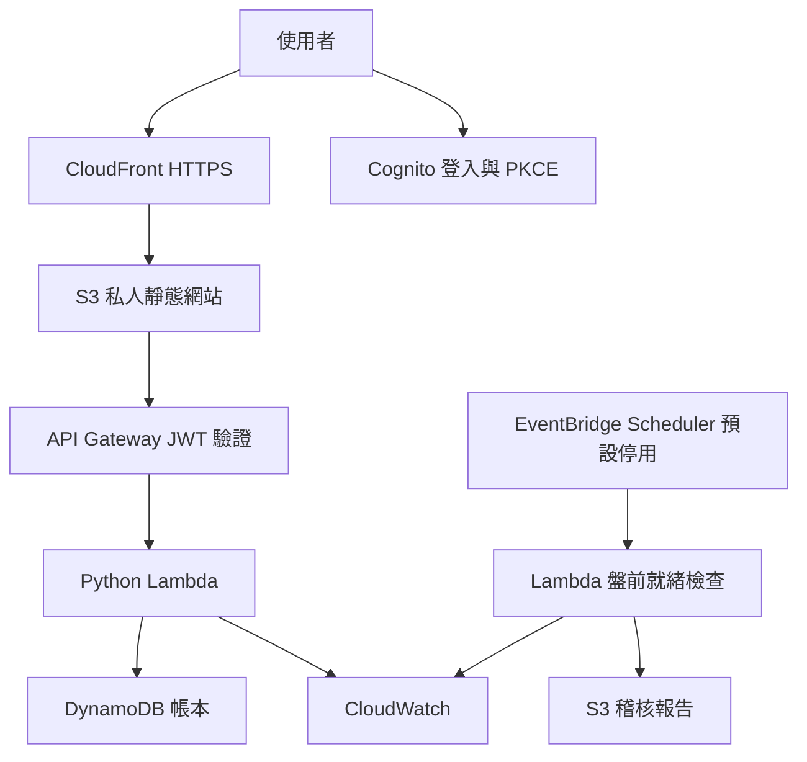
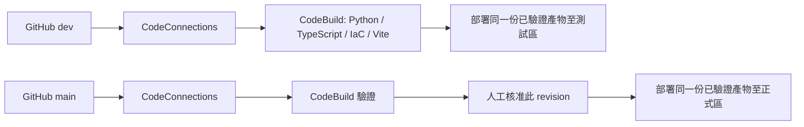

# Baglo

把直覺，交給驗證。以 Python 與 AWS Serverless 建立的股票研究、AI 建議與模擬交易專案。

## 目前可以做什麼

- React + TypeScript + Vite 靜態響應式前端：交易工作台、官方研究資料、委託紀錄。
- 以代號、名稱搜尋上市櫃普通股，提供收盤價區間篩選、鍵盤選取與清除條件。
- 富果整股／零股分開報價；未設定金鑰或來源失敗時顯示官方最近收盤參考，不冒充現價。
- 選股自動帶入參考價；改價後更新報價不覆蓋自訂限價，提供升降單位加減鍵與送出前確認。
- TWSE／TPEx 官方歷史日線、SMA20／60、營收成長率、估值與三大法人資料，逐項標示來源及日期。
- 每個帳戶初始虛擬本金 NT$300,000；限價委託、取消、資金／持倉保留。
- 下單可切換整股（張）與零股（股）：普通股每張 1,000 股，零股每筆 1～999 股；前端換算總股數，後端獨立檢查交易類別。
- 即時顯示預估委託金額、手續費、賣出稅與保留金額；委託紀錄顯示整股／零股與張數。
- 重複請求防護、禁止放空；不設單筆金額上限，仍檢查現金與持倉。
- 本機 SQLite 持久化；Lambda 使用 DynamoDB 條件寫入，避免並行修改覆蓋帳本。
- 本機限定的沙盒成交，用輸入限價驗證帳務；明確標示為非真實行情。
- AWS SAM 模板：Lambda、HTTP API、Cognito、DynamoDB、私人 S3、CloudFront、排程與日誌。
- AWS CodePipeline 設定檔：dev／main 分流、CodeBuild 驗證、正式區人工核准、部署 Lambda + S3；目前依要求不建立或啟用 AWS 資源。

**目前仍沒有行情驅動的自動撮合。** 已加入 不限原六檔的 AI 三面向分析背景工作、推薦採用、每日自動模擬設定及保存紀錄，但需另設 OpenAI 後端金鑰才能呼叫模型；本機沒有每日排程。雲端日程的 IaC 已備妥但尚未部署或啟用，且帳戶必須加入排程名單及自行開啟授權。AI 建議只會透過獨立風控建立待成交模擬委託，不送券商真單、不把舊價假設為成交價。

視覺方向參考 [RonDesignLab 的 E*TRADE 設計](https://dribbble.com/shots/21333645-E-TRADE-Online-Trading-Platform)：深色交易終端、低彩度邊框、三欄工作區與紅買綠賣按鈕；保留 Baglo 品牌，自行實作元件，沒有使用參考圖的品牌素材。

## 本機啟動

需要 Python 3.12、Node.js 24、pnpm 11.25。後端本機使用 Python 標準函式庫；前端需先安裝並編譯。

```bash
python3.12 -m venv .venv
source .venv/bin/activate
python -m pip install -r requirements-dev.txt
pnpm --dir frontend install --frozen-lockfile
python scripts/build_frontend.py
PYTHONPATH=backend python -m baglo.local --demo --port 8000
```

開啟 <http://127.0.0.1:8000>。本機僅綁定 loopback，由開發伺服器注入固定沙盒身分，不是雲端登入。移除 `--demo` 後仍能建立／取消委託，但不能沙盒成交。啟動時預設讀取 `.env.local`，僅允許指定的後端設定；金鑰不進入前端。本機帳本在 `data/baglo.db`，不會上傳 Git。

金額 API 一律以整數「分」傳遞，股數以整數「股」傳遞。`market_type` 為 `board_lot`（整股）或 `odd_lot`（零股），整股下單時 API 的 `quantity` 仍為總股數：1 張傳 `1000`，不是 `1`。未傳 market_type 的舊客戶端依股數推定，原有帳本與請求編號不改寫。整股數量須為 1,000 的倍數，本版最多 499 張；零股限 1～999 股。混合數量需分別委託；兩種市場共用資金與持倉保留，不能重複賣出。例如 NT$1,000 為 `100000`。交易單位依據 [TWSE 交易制度說明](https://www.twse.com.tw/zh/products/system/trading.html)；目前支援經資料來源驗證的四碼上市櫃普通股，不推廣至交易單位不同的商品。

本版手續費為成交金額 0.1425%，最低 NT$20；賣出股票稅率 0.3%。已檢查來源漲跌停價格；未模擬委託簿、交易量、除權息、滑價、交易日及 T+2 交割，因此沙盒結果不能當成投資績效。

```bash
python -m pytest -q
node --experimental-strip-types --test tests/chart-data.test.ts
cfn-lint infra/template.yaml infra/bootstrap.yaml
python scripts/build_frontend.py
```

## API

| 方法 | 路徑 | 用途 |
|---|---|---|
| GET | `/api/health` | 公開健康檢查 |
| GET | `/api/config` | 公開前端設定，無秘密 |
| GET | `/api/account` | 自己的帳戶、持倉與委託 |
| POST | `/api/orders` | 建立委託，需 `Idempotency-Key` |
| POST | `/api/orders/{id}/cancel` | 取消自己帳戶的待成交委託 |
| POST | `/api/orders/{id}/demo-fill` | 僅本機沙盒可用 |
| GET | `/api/analysis` | AI 分析尚未設定，不產生虛構建議 |
| GET | `/api/instruments?q=2330&min_price=30&max_price=100` | 代號／名稱與價格搜尋；價格篩選以元為單位 |
| GET | `/api/market/{symbol}?market_type=odd_lot` | 富果報價或明確標示的官方收盤參考 |
| GET | `/api/history/{symbol}` | 分頁查詢未還原官方日線與均線（months 1～6、offset 0～114） |
| GET | `/api/research/{symbol}` | 月營收成長、估值與法人買賣超 |

雲端由 API Gateway 驗證 Cognito access token 與 `baglo-api/access` scope。Lambda 以已驗證的 `sub` 隔離帳戶，不接受前端傳入帳戶 ID。前端使用 Authorization Code + PKCE，access token 只保留在分頁的 sessionStorage，不把金鑰放入網站。

## 資料來源與價格體驗

- 上市：TWSE OpenAPI 日成交、月營收、估值；歷史日線使用官方 STOCK_DAY 月份查詢，法人使用 T86 盤後報表。
- 上櫃：TPEx OpenAPI 日成交、月營收、估值、法人；歷史使用官方 tradingStock 月份查詢。來源成交量以張呈現時轉為股數，保留官方報表本身的精度限制。
- 富果：使用 REST Quote 與 `type=oddlot` 分開查詢整股／零股；取 `lastTrade` 的實際成交，不把 `lastTrial` 或含試撮的 `lastPrice` 當成交。
- 本版範圍為四碼、首碼 1～8 的上市櫃普通股，排除 ETF、TDR、權證與其他交易單位不同的商品；不是全商品搜尋。
- 搜尋價格是最近收盤參考，不是盤中篩選器。富果報價以成交時間、休市／試撮旗標與 120 秒時效判斷是否可標示現價；舊成交、休市與快取失效各自標示，不觸發自動成交。
- 日成交快取 15 分鐘、財務／法人／月份日線快取 6 小時、富果報價快取 30 秒。各執行個體另有短期索引快取，更新不是逐筆串流，也不保證正好每 30 秒呼叫上游。沒有前端背景輪詢。
- 本機快取在 `data/market-cache/`；Lambda 快取在 ResearchBucket 的 `market/`。更新失敗時，只能回傳標示舊快取的最近 7 天取得資料，保留原本時間；沒有快取則回傳明確錯誤。相同執行個體失敗後暫停重試 60 秒。
- 單一來源失敗時，搜尋顯示部分可用與提示。圖表只畫實際日線，快速切換標的會捨棄舊請求的畫面更新。價格缺失時可手動輸入，不能自動補成即時成交。
- 未還原股價受除權息影響；月營收出表日不是公司最早公告時間。尚未建立完整 point-in-time 基本面回測資料，不能用目前快照回填過去的 AI 決策。

### 富果本機設定

複製 `.env.example` 為 `.env.local`，填入 `BAGLO_FUGLE_API_KEY`。`.env.local` 被 Git 忽略；不要把金鑰放入 `frontend/public/config.json`。既有本機金鑰設定不隨 repository 上傳。

### 富果雲端設定

先在 Secrets Manager 保存金鑰（SecretString 可為純金鑰或 `{"FUGLE_API_KEY":"..."}`）。GitHub repository variables 分別設定 `BAGLO_DEV_FUGLE_SECRET_ARN`、`BAGLO_PROD_FUGLE_SECRET_ARN`，只存 ARN；部署流程將 ARN 傳入 SAM 的 `FugleSecretArn`。Lambda 角色僅可讀取指定秘密。若未提供 ARN，部署仍可用官方收盤資料，不會啟用富果報價。自管 KMS 金鑰另需檢查解密權限。

來源：[TWSE](https://openapi.twse.com.tw/)、[TPEx](https://www.tpex.org.tw/openapi/)、[Fugle Quote](https://developer.fugle.tw/docs/data/http-api/intraday/quote/)。來源權限與額度依各服務條款，本專案不繞過限流。

## 雲端架構與選用原因



- Lambda：短任務按需執行，免管理常駐主機。先避免 Pandas 等大型依賴。
- S3 + CloudFront：前端完全靜態，私人 origin 與 HTTPS，不需要 Next.js server 或 EC2。
- DynamoDB：單一帳戶的資金、持倉、委託在同一筆版本控制快照原子更新；讀取採強一致性，衝突時重新讀取。不是讀完後直接覆蓋。
- Cognito：雲端每個帳戶獨立；只允許管理者建立使用者。
- SAM／CloudFormation：宣告資源、角色、API、前端託管及排程，以環境參數建立 `baglo-dev`、`baglo-prod`。
- S3：保存原始資料及日後分析快照，避免把大量資料放在 Lambda 暫存磁碟。

帳本 MVP 最多 150 筆委託／300 KB，達上限明確拒絕新委託，不刪除舊紀錄；下一階段改為獨立委託／成交項目與交易寫入。S3、資料表、使用者池刪除 stack 後保留，仍可能計費。DynamoDB PITR、CloudFront、Cognito、日誌與 CI 分鐘也需依帳號額度估費；此模板不保證全部免費。

## AWS CodePipeline（僅準備設定，目前不啟用）



`infra/codepipeline.yaml` 每個環境各建一條 Pipeline，環境資料、網站及使用者池獨立。V2 採 QUEUED；驗證專案不能部署，部署專案使用指定部署角色。建置成功的前端產物直接晉升，不重新抓新 commit 或重編前端。GitHub Actions 僅保留手動檢查，不再因 push 重複部署。

**使用者要求目前不使用 AWS，所以本次沒有執行下方部署指令、建立資源或啟用排程。** 準備統一部署時，先確認 main 與 dev 都有本次程式，再檢視 `infra/bootstrap.yaml` 與 `infra/codepipeline.yaml` 的角色與費用。CodeBuild、Pipeline、日誌、秘密管理與模型都可能計費，不保證完全免費。

日後可在已登入的 CloudShell checkout 此專案 dev 分支後執行：

```bash
# 僅在決定統一部署後執行；Connection 必須同區域、AVAILABLE，且可讀 kos8123/Baglo。
bash scripts/setup_codepipeline.sh '<GitHub Connection ARN>'
```

腳本僅建立／更新 Baglo 的 bootstrap 與 pipeline stacks，不碰舊 CloudQuant。預設區域 us-east-1；已有 bootstrap 時保留原 OIDC 參數。尚未做 AWS 端實測。若產物桶另外啟用了 S3 versioning，部署角色需另行審查物件版本讀取權限，本次未增加該授權。

可選的後端設定為 `BAGLO_FUGLE_SECRET_ARN`、`BAGLO_OPENAI_SECRET_ARN`、`BAGLO_OPENAI_MODEL`。秘密值僅放 Secrets Manager。未設定富果漲跌停或有效即時行情時，AI 不會建單。AI 排程另須 `BAGLO_AI_SCHEDULE=ENABLED`、`BAGLO_AI_ACCOUNTS`（允許的 Cognito sub 清單），預設全部停用。

管理者需日後在 Cognito 建立登入帳戶；不要將密碼或 token 提交至 repository。雲端不提供本機沙盒身分或成交按鈕。

## 使用者驗收範圍

- 代號、中文名稱、全形數字、台／臺與 `.TW` 後綴搜尋；能選到原本六檔以外的上市、上櫃股票。
- 以價格區間篩選時清除原本的已選搜尋文字；最多顯示 20 個建議，可進一步輸入名稱縮小範圍。
- 輸入新搜尋立即取消舊建議的可選狀態；未選擇新標的時，禁止誤將搜尋文字當作已選股票送單。
- 方向鍵與 Enter 選取、Escape 關閉建議，選取列捲入可視範圍。
- 選股自動帶入富果對應市場報價；手動改價後按更新保留自訂值，按帶入參考價才恢復自動價格。
- 下單確認視窗按 Escape 不新增委託；按確認只新增一筆，取消後釋放保留資金。
- 圖表只呈現實際取得的資料；上櫃歷史成交量的張／股換算有測試。
- 來源失敗、部分市場不可用、舊快取、休市成交價與即時報價不混用；並行與重複委託維持原本帳務測試。

本次僅進行編譯、單元與基本連線檢查；互動驗收交由使用者依 docs/ACCEPTANCE.md 執行。AWS 尚未部署。

## 下一階段

1. 擴充完整財報、公告時間、歷史修訂版本與資料品質檢查，完成模型與每日排程實測。
2. 補齊交易日、流動性、報價買賣盤單位與撮合規則，再實作行情驅動模擬成交與交割限制。
3. AI 已有 OpenAI 結構化建議介面；下一步需設定金鑰、驗證模型及費用，失敗或缺資料即不建單。
4. AI 推薦需手動確認；自動模式目前用每筆預算、信心門檻、現金／持倉及重複委託防護，尚需更完整單日曝險與市場撮合研究。
5. 分別比較手動、固定規則及 AI 的成本後績效，不以短期沙盒結果宣稱獲利。

## AI 輔助開發紀錄

使用 Codex 協助需求拆解、Python 帳務與儲存介面、靜態 UI、SAM 模板、CI/CD 與測試案例。人工需求包括純模擬、從零開始、免費優先、獨立 Git 歷史。開發驗證包含單元測試、並行寫入與隔離測試、模板 lint，以及本機瀏覽器實際建立／成交沙盒委託。

心得：AI 可以加快第一版，但必須用測試驗證資金守恆、重複請求與權限邊界；模板 lint 不代表 AWS 部署成功，UI 有按鈕也不代表資料或模型已接入。限制與未實作功能必須在畫面及文件直接呈現。

### 交易工作台更新

日 K 線改由 TradingView Lightweight Charts 依真實 OHLC 繪製，紅漲綠跌；提供十字游標、開高低收與成交量、滾輪縮放、拖曳、放大縮小與重設。歷史資料先載入半年，再逐批擴充至近三年；可手動載入更多，最多最近十年，實際以來源可用資料為準，不含還原權息。

日 K、週 K、月 K 可切換；週線以週一為界，月線以曆月為界。各棒取首日開盤、最高、最低、末日收盤與成交量加總；最近週／月尚未結束時為截至最新交易日的部分期間，來源缺漏不補造資料。十字線吸附選定 K 棒的日期與收盤價；預設顯示 120 根日線、104 根週線或 60 根月線（資料不足時顯示實有根數），保留縮放和拖曳。

買進／賣出按鈕分開，送出前需確認方向、數量、價格與費用，完成後可點通知前往委託紀錄。取消原本單筆本金 20% 的金額限制；保留資金、持倉、升降單位及交易股數規則。

漲跌停使用 Fugle intraday ticker 的 limitUpPrice / limitDownPrice 與日期，不以昨收推算，避免除權息與新掛牌例外誤判。平日只接受當日資料；週末僅容許最近四日內來源的歷史交易日模擬，明示日期，不代表下個交易日範圍。來源缺漏、過期、無有效上下限（含尚未支援的無漲跌幅情境）暫停新增委託；取消委託與既有請求重播仍可用。

## React 交易終端

- React 19 + TypeScript + Vite 7；Tailwind CSS 4 管線與統一交易版面樣式。
- Radix Dialog、CVA 按鈕等 shadcn/ui 式可控元件（元件程式保存在本庫），Lucide 圖示。
- TanStack Query 管理搜尋、行情、歷史分頁、研究與帳戶狀態；寫入不自動重試，委託保留原始冪等編號。
- Lightweight Charts 5 提供 Canvas K 棒、成交量副圖、磁吸收盤十字線、拖曳、縮放、全部歷史與重設。週／月由真實日線聚合，沒有推估缺漏日。保留 TradingView 歸屬與授權。
- `frontend/src/components` 分為 StockSearch、PriceChart、OrderTicket、Orders、Positions、Research 與 UI primitives。舊的 DOM 操作與 SVG 已移除，Git 歷史可取回。
- `scripts/build_frontend.py` 執行 TypeScript 與 Vite，輸出 `dist/`，再注入公開的 API URL。Lambda 不需 Node；前端沒有 SSR 或 EC2 需求。
- 本機 Python 8000 埠提供 `dist/` 與 API。前端開發可另執行 `pnpm --dir frontend dev`，開啟 5173；Vite 代理 `/api` 到 8000。

本次僅執行編譯、既有後端檢查與資料聚合檢查。互動與跨裝置驗收由使用者依 [驗收清單](docs/ACCEPTANCE.md) 操作；尚未宣稱所有瀏覽器操作驗收通過。

## 本機 AI、Swagger 與持倉

- 左側導覽加入「我的持倉」「AI 模擬交易」「Swagger API」，移除頂部重複導覽；手機保留左側圖示。
- 持倉成本依已記錄成交採移動平均且含買進費用；缺少成本紀錄不推估。未實現損益未扣未來賣出費稅；參考估值逐筆列來源與時間，不冒充即時。
- Swagger 位於 `/docs/index.html`，OpenAPI 位於 `/api/openapi.json`。UI 套件隨網站部署，不讀取或保存後端 API key；雲端測試只接受自己的 Cognito token。
- 本機 `.env.local` 可另設 `BAGLO_OPENAI_API_KEY`、`BAGLO_OPENAI_MODEL`，重啟後生效。富果金鑰無法代替 OpenAI 金鑰。沒有模型金鑰仍可使用手動模擬。
- AI 工作非同步執行，先取得公開技術／基本／籌碼快照並保存後才呼叫模型；不傳送帳戶餘額、持倉或個人資料給模型。輸出只包含動作、信心與理由，股數與價格由後端依預算重新計算。模型不得直接呼叫下單 API。
- 每帳戶保留近期完成工作、尚在處理工作及當日排程紀錄；原始輸入快照留在本機 `data/ai-inputs/` 或雲端私人資料桶。不回填過去決策。工作逾時明示失敗，模型呼叫不自動重試。
- 雲端預備流程：08:30 分析、09:05 重新檢查當日分析與可信即時零股報價後建模擬單；非交易時段、休市舊價、低信心、缺資料或資金／持倉不符一律跳過。排程與帳戶授權雙重停用預設。

[OpenAI Structured Outputs](https://developers.openai.com/api/docs/guides/structured-outputs)；[AWS CodePipeline](https://docs.aws.amazon.com/codepipeline/latest/userguide/pipeline-requirements.html)。本次沒有付費模型實測或 AWS 部署，不宣稱已驗證每日自動交易。

AI 標的池現可透過搜尋加入任何資料來源已驗證的四碼上市櫃普通股，或加入目前選股；不再使用六檔白名單，也不限制標的池只能六檔。儲存新標的池時後端向來源登錄表驗證，分析時再次驗證。ETF、TDR、權證目前仍不在系統資料支援範圍。大量標的仍受資料額度、模型費用、排程時間與帳本容量約束；本機同時工作容量限制與股票白名單分開。AWS 維持未部署、未啟用。

## 策略回測與信心門檻

AI 門檻以百分比顯示（例如 70%），僅代表模型自評分數，不是經驗證的勝率或獲利機率。達門檻仍須通過獨立風控。

左側「策略回測」可比較 SMA 短／長均線、N 日高點突破及買入持有；選擇股票、歷史日期、虛擬本金、整股／零股與滑價。後端先取得暖機資料，訊號僅用前一天收盤前資料，下一交易日開盤加滑價；費用使用同一套預設 0.1425%／最低 20 元與 0.3% 賣出稅。持倉最多前一交易日成交量 1%，零股每筆最多 999 股，不使用成交日最終成交量來決定部位大小。

結果包含報酬、年化、最大回撤、Sharpe、勝率（僅已完成來回交易）、換手、費用、滑價、每日權益與逐筆紀錄，可下載 JSON。前 70% 與後 30% 獨立以相同初始資金與固定參數測試，並比較保留區間買入持有。反覆使用保留區調參仍有過擬合風險，不宣稱無偏的正式樣本外實驗。

回測與既有模擬帳本隔離，不下單、不扣除模擬帳戶資金、不呼叫 AI。使用未還原日線、目前仍掛牌標的，存在除權息與存活者偏差；尚未模擬歷史漲跌停競價基準、盤口、交割及暫停交易。無量／單一價格日保守跳過。期末持倉按收盤估值，不假設賣出。歷史資料缺漏會標示警告。固定策略回測不能用今天模型回填過去，不能據此證明 AI 信心分數準確。

API：`POST /api/backtests` 建立非同步工作，`GET /api/backtests/{id}` 只能讀取自己帳戶的報告。輸入價格均為分。報告及實際 OHLCV 保存於本機忽略目錄 `data/market/backtests/`；未啟用 AWS。
