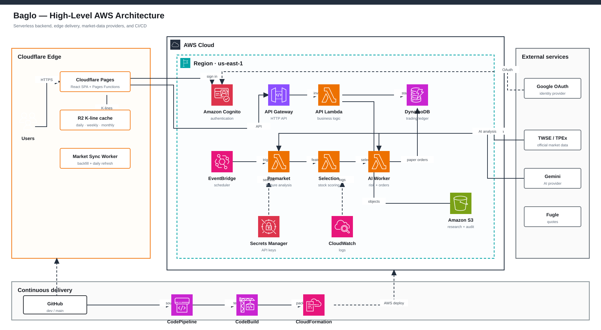
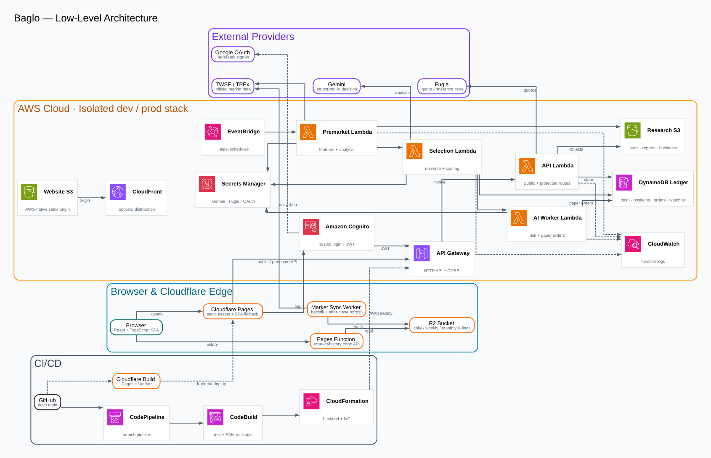

# Baglo

Baglo 是台股 AI 研究與模擬交易平台，用於展示 Serverless 雲端架構、CI/CD 與 AI 輔助開發。

> 只提供模擬交易，不連接券商、不使用真實資金，也不構成投資建議。

## 主要功能

- 訪客可搜尋台股，查看價格與日／週／月 K 線。
- Cognito 帳號註冊、密碼登入與 Google 登入。
- 整股、零股模擬下單，含漲跌停、費稅與重複請求防護。
- 資金、持倉、委託與取消紀錄。
- 技術面、基本面、籌碼面資料與 AI 模擬建議。
- AI 自動交易與回測流程；未通過資料、信心或風控條件時不建單。

## 雲端架構

- **Frontend:** React、TypeScript、Vite、TanStack Query、Lightweight Charts
- **Hosting:** Cloudflare Pages、R2 K 線快取與 Worker 每日預填
- **Backend:** Python 3.12、AWS Lambda、API Gateway
- **Identity:** Cognito + Google OAuth
- **Storage:** DynamoDB、S3
- **IaC / CI/CD:** AWS SAM / CloudFormation、CodePipeline、CodeBuild
- **Data / AI:** TWSE、TPEx、Fugle、Gemini

### High Level



主要請求由 Cloudflare Pages 進入 AWS Serverless 後端；登入由 Cognito 處理，API Gateway 將請求交給 Lambda，交易帳本與研究資料分別保存在 DynamoDB 與 S3。EventBridge Scheduler 觸發盤前分析、選股與 AI 模擬下單流程。

### Low Level



- 公開 API 提供設定、標的搜尋與市場資料；帳戶、持倉、委託、自選股及 AI 操作必須帶 Cognito JWT。
- Cloudflare R2 保存預先整理的日／週／月 K 線，Worker 負責回填與收盤後更新，減少每次開圖時直接呼叫上游行情 API。
- `dev` 與 `prod` 使用獨立 CloudFormation stack；GitHub 變更由 CodePipeline、CodeBuild 與 SAM／CloudFormation 驗證及部署。
- Cloudflare Pages 是目前主要前端；S3 + CloudFront 保留為 AWS 原生靜態網站路徑。

圖中的 AWS 服務圖示取自 [AWS Architecture Icons](https://aws.amazon.com/architecture/icons/)；Cloudflare、GitHub、Google 與資料供應商以中性方塊表示，避免誤認為 AWS 服務。

## 本機啟動

需要 Python 3.12、Node.js 24 與 pnpm。

```bash
python3.12 -m venv .venv
source .venv/bin/activate
python -m pip install -r requirements-dev.txt
pnpm --dir frontend install --frozen-lockfile
python scripts/build_frontend.py
PYTHONPATH=backend python -m baglo.local --demo --port 8000
```

開啟 <http://127.0.0.1:8000>。

## 測試

```bash
python -m pytest -q
node --experimental-strip-types --test tests/*.test.ts
cfn-lint infra/template.yaml infra/bootstrap.yaml infra/codepipeline.yaml
```

## 部署

`dev` 對應測試環境；`main` 對應正式環境並保留人工核准。Cloudflare Pages 部署前端，AWS CodePipeline 驗證並部署後端與 IaC。

[CI/CD 說明](docs/CICD.md) · [Cloudflare Pages](docs/CLOUDFLARE_PAGES.md) · [驗收清單](docs/ACCEPTANCE.md)

## 限制

- 行情可能受第三方 API 延遲、額度或中斷影響。
- 尚未完整模擬委託簿、T+2、除權息與全部市場特例。
- AI 輸出只是模擬研究結果，不保證正確或獲利。

## AI 輔助開發

使用 Codex 協助需求拆解、程式實作、測試、除錯與雲端部署；權限、帳務與部署結果仍透過自動測試與人工驗證。
