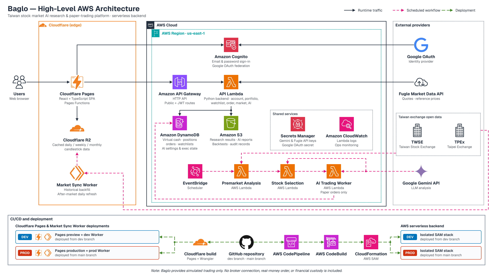

# Baglo

Baglo 是台股 AI 研究與模擬交易平台，用於展示 Serverless 雲端架構、CI/CD 與 AI 輔助開發。

> 只提供模擬交易，不連接券商、不使用真實資金，也不構成投資建議。

## 主要功能

- 訪客可搜尋台股，查看價格與日／週／月 K 線。
- Cognito 帳號註冊、密碼登入與 Google 登入。
- 整股、零股模擬下單，含漲跌停、費稅與重複請求防護。
- 資金、持倉、委託與取消紀錄。
- 技術面、基本面、籌碼面資料與 AI 模擬建議。
- AI 自動交易與回測流程；未通過資料、信心或風控條件時不建單。

## 雲端架構

- **Frontend:** React、TypeScript、Vite、TanStack Query、Lightweight Charts
- **Hosting:** Cloudflare Pages、R2 K 線快取與 Worker 每日預填
- **Backend:** Python 3.12、AWS Lambda、API Gateway
- **Identity:** Cognito + Google OAuth
- **Storage:** DynamoDB、S3
- **IaC / CI/CD:** AWS SAM / CloudFormation、CodePipeline、CodeBuild
- **Data / AI:** TWSE、TPEx、Fugle、Gemini



圖中的 AWS 服務圖示取自 [AWS Architecture Icons](https://aws.amazon.com/architecture/icons/)；Cloudflare、GitHub、Google 與資料供應商以中性方塊表示，避免誤認為 AWS 服務。

## 文件導覽

| 文件 | 內容 |
| --- | --- |
| [ARCHITECTURE.md](docs/ARCHITECTURE.md) | High／Low Level 架構圖、元件責任、資料流、安全邊界與系統限制 |
| [CICD.md](docs/CICD.md) | CI/CD Pipeline 與 GitHub Workflow 圖、分支與環境、部署驗證、失敗處理與回退 |
| [CHALLENGES.md](docs/CHALLENGES.md) | 開發中實際遇到的問題：發現問題 → 發生原因 → 解法 |

## 本機啟動

需要 Python 3.12、Node.js 24 與 pnpm。

```bash
python3.12 -m venv .venv
source .venv/bin/activate
python -m pip install -r requirements-dev.txt
pnpm --dir frontend install --frozen-lockfile
python scripts/build_frontend.py
PYTHONPATH=backend python -m baglo.local --demo --port 8000
```

開啟 <http://127.0.0.1:8000>。

## 測試

```bash
python -m pytest -q
node --experimental-strip-types --test tests/*.test.ts
cfn-lint infra/template.yaml infra/bootstrap.yaml infra/codepipeline.yaml
```

## AI 輔助開發

使用 Codex 協助需求拆解、程式實作、測試、除錯與雲端部署；權限、帳務與部署結果仍透過自動測試與人工驗證。
