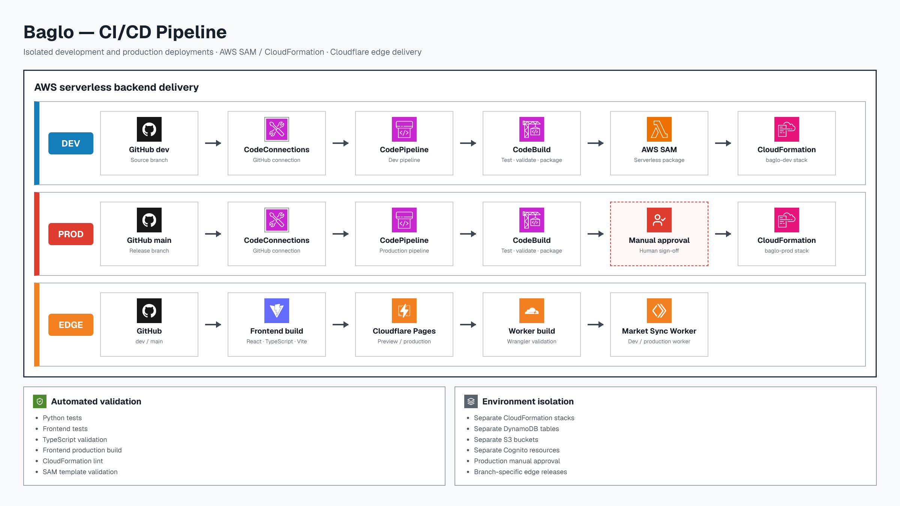

# Baglo

Baglo 是台股 AI 研究與模擬交易平台，用於展示 Serverless 雲端架構、CI/CD 與 AI 輔助開發。

> 只提供模擬交易，不連接券商、不使用真實資金，也不構成投資建議。

## 主要功能

- 訪客可搜尋台股，查看價格與日／週／月 K 線。
- Cognito 帳號註冊、密碼登入與 Google 登入。
- 整股、零股模擬下單，含漲跌停、費稅與重複請求防護。
- 資金、持倉、委託與取消紀錄。
- 技術面、基本面、籌碼面資料與 AI 模擬建議。
- AI 自動交易與回測流程；未通過資料、信心或風控條件時不建單。

## 雲端架構

- **Frontend:** React、TypeScript、Vite、TanStack Query、Lightweight Charts
- **Hosting:** Cloudflare Pages、R2 K 線快取與 Worker 每日預填
- **Backend:** Python 3.12、AWS Lambda、API Gateway
- **Identity:** Cognito + Google OAuth
- **Storage:** DynamoDB、S3
- **IaC / CI/CD:** AWS SAM / CloudFormation、CodePipeline、CodeBuild
- **Data / AI:** TWSE、TPEx、Fugle、Gemini

### High Level


High Level 圖呈現完整系統邊界與主要資料流。使用者從 Edge 前端進入系統，Cognito 負責帳號與 Google OAuth，API Gateway 將同步請求交給 Python API Lambda，DynamoDB 保存模擬帳務狀態，S3 保存研究、回測與稽核資料。EventBridge 依排程啟動盤前分析、AI 選股與模擬交易；TWSE、TPEx、Fugle 與 Gemini 位於 AWS 外部。底部則顯示 `dev`、`main` 對應的前後端部署流程。

### Low Level


Low Level 圖展開每個元件的責任與安全邊界：公開行情路由可以匿名讀取，帳戶、持倉、委託、自選股及 AI 操作則由 Cognito JWT 保護。API Lambda 透過 IAM 存取 DynamoDB 與 S3；排程 Lambda 依序完成資料驗證、盤前研究、候選股評分及風控後的模擬下單。Secrets Manager 保存第三方金鑰，CloudWatch 集中記錄執行狀態。`dev` 與 `prod` 使用隔離的 pipeline、stack、資料表、bucket 與身分資源。

圖中的 AWS 服務圖示取自 [AWS Architecture Icons](https://aws.amazon.com/architecture/icons/)；Cloudflare、GitHub、Google 與資料供應商以中性方塊表示，避免誤認為 AWS 服務。

### CI/CD Pipeline



`dev` 分支會進入開發 pipeline，完成測試、CloudFormation lint、SAM 驗證與封裝後部署至 `baglo-dev`；`main` 分支使用獨立的 production pipeline，並在部署 `baglo-prod` 前保留人工核准。前端與 Market Sync Worker 依分支產生 preview／production 版本。兩個環境的 stack、DynamoDB、S3 與 Cognito 資源彼此隔離，降低測試變更影響正式環境的風險。

### GitHub Workflow


功能從短期 feature branch 開始，先執行本機測試，再透過 Pull Request 合併至 `dev` 並部署測試環境。確認登入、行情、K 線、模擬委託與 AI 流程後，再建立 `dev → main` 的 release PR。正式部署需要完整 CI、基礎設施差異檢查與人工核准；部署後執行 smoke test、查看 CloudWatch，必要時回復上一個已驗證版本。

CI/CD 與 GitHub Workflow 圖使用 [Takumi CLI](https://takumi.kane.tw/docs/cli) 由版本化 HTML 產生，來源位於 `docs/architecture/`。

## 開發過程遇到的難題

| 問題 | 調整與解法 |
| --- | --- |
| Cloudflare 網域呼叫 API Gateway 時被 CORS 阻擋 | 將實際前端網域加入 API Gateway／Lambda CORS 設定，並區分公開路由與需要 Cognito JWT 的受保護路由。 |
| K 線第一次載入超過十秒，而且部分股票歷史資料不足 | 將日、週、月 K 線預先整理後存入 R2，由 Market Sync Worker 回填歷史資料並在收盤後增量更新，前端優先讀取快取。 |
| TPEx 來源發生重複導向，部分代號無法取得完整資料 | 加入來源驗證、逾時與 fallback；AI 選股前先檢查代號、名稱、流動性與歷史資料完整度，不足的標的直接略過。 |
| 搜尋到股票後，下單區仍判定沒有選取；成功委託有時顯示失敗 | 將原生頁面遷移到 React 共用狀態，以 TanStack Query 管理伺服器資料，並使用 idempotency key 與明確的 API 成功狀態避免重複或錯誤提示。 |
| 重新整理後自選股與 AI 選出的股票消失 | 將自選股、AI 設定、候選股與執行紀錄依 Cognito 使用者保存到 DynamoDB，不再只放在瀏覽器記憶體。 |
| 訪客、註冊會員與 Google 登入的權限需求不同 | 訪客僅能看盤；註冊、登入、Google OAuth 與 PKCE 交給 Cognito，交易、帳務與 AI API 統一驗證 JWT。 |
| GitHub Connection、IAM 權限與 CloudFormation 更新曾造成 pipeline 失敗或 rollback | 使用 CodeConnections、最小權限 IAM、SAM／CloudFormation 驗證與 dev／prod 隔離；部署失敗先讀取 stack events，只清理已確認為空的殘留資源。 |
| AI 模型可能遇到金鑰、額度或模型費用問題 | 金鑰集中放在 Secrets Manager，模型名稱改為部署參數；AI 呼叫失敗時不建立委託，並保留失敗原因供使用者查詢。 |

## 本機啟動

需要 Python 3.12、Node.js 24 與 pnpm。

```bash
python3.12 -m venv .venv
source .venv/bin/activate
python -m pip install -r requirements-dev.txt
pnpm --dir frontend install --frozen-lockfile
python scripts/build_frontend.py
PYTHONPATH=backend python -m baglo.local --demo --port 8000
```

開啟 <http://127.0.0.1:8000>。

## 測試

```bash
python -m pytest -q
node --experimental-strip-types --test tests/*.test.ts
cfn-lint infra/template.yaml infra/bootstrap.yaml infra/codepipeline.yaml
```

## 部署

`dev` 對應測試環境；`main` 對應正式環境並保留人工核准。Cloudflare Pages 部署前端，AWS CodePipeline 驗證並部署後端與 IaC。

[架構說明](docs/ARCHITECTURE.md) · [CI/CD 與 Git 工作流](docs/CICD.md) · [問題與解法](docs/CHALLENGES.md)

## 限制

- 行情可能受第三方 API 延遲、額度或中斷影響。
- 尚未完整模擬委託簿、T+2、除權息與全部市場特例。
- AI 輸出只是模擬研究結果，不保證正確或獲利。

## AI 輔助開發

使用 Codex 協助需求拆解、程式實作、測試、除錯與雲端部署；權限、帳務與部署結果仍透過自動測試與人工驗證。
