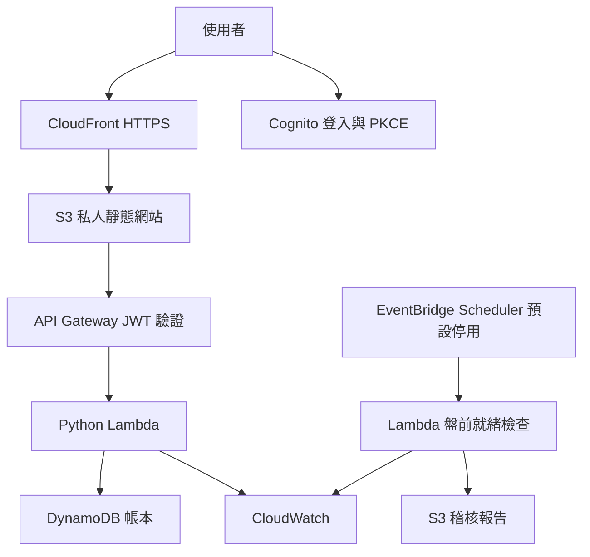
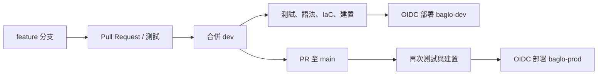

# Baglo

把直覺，交給驗證。以 Python 與 AWS Serverless 建立的股票研究、AI 建議與模擬交易專案。

## 目前可以做什麼

- 靜態、響應式前端：交易工作台、盤前研究狀態、委託紀錄。
- 每個帳戶初始虛擬本金 NT$300,000；限價委託、取消、資金／持倉保留。
- 重複請求防護、禁止放空、單筆買入最高 NT$60,000。
- 本機 SQLite 持久化；Lambda 使用 DynamoDB 條件寫入，避免並行修改覆蓋帳本。
- 本機限定的沙盒成交，用輸入限價驗證帳務；明確標示為非真實行情。
- AWS SAM 模板：Lambda、HTTP API、Cognito、DynamoDB、私人 S3、CloudFront、排程與日誌。
- GitHub Actions：測試、JavaScript 語法檢查、IaC 驗證、靜態檔建置；完成 AWS bootstrap 後可依分支自動部署。

**目前沒有真實行情撮合、三面資料分析、OpenAI 呼叫或 AI 自動交易。** 研究室會顯示尚未接入，部署版委託保持待成交。排程預設停用；啟用後目前只寫入「資料未就緒」稽核報告，不產生交易。所有帳戶均為模擬，不連接券商。

## 本機啟動

需要 Python 3.12。應用本身使用標準函式庫；測試另需安裝開發依賴。

```bash
python3.12 -m venv .venv
source .venv/bin/activate
python -m pip install -r requirements-dev.txt
PYTHONPATH=backend python -m baglo.local --demo --port 8000
```

開啟 <http://127.0.0.1:8000>。本機僅綁定 loopback，由開發伺服器注入固定沙盒身分，不是雲端登入。移除 `--demo` 後仍能建立／取消委託，但不能沙盒成交。本機帳本在 `data/baglo.db`，不會上傳 Git。

金額 API 一律以整數「分」傳遞，股數以整數「股」傳遞。例如 NT$1,000 為 `100000`。本版手續費為成交金額 0.1425%，最低 NT$20；賣出股票稅率 0.3%。未模擬委託簿、交易量、漲跌停、除權息、滑價、交易日及 T+2 交割，因此沙盒結果不能當成投資績效。

```bash
python -m pytest -q
node --check frontend/app.js
cfn-lint infra/template.yaml infra/bootstrap.yaml
python scripts/build_frontend.py
```

## API

| 方法 | 路徑 | 用途 |
|---|---|---|
| GET | `/api/health` | 公開健康檢查 |
| GET | `/api/config` | 公開前端設定，無秘密 |
| GET | `/api/account` | 自己的帳戶、持倉與委託 |
| POST | `/api/orders` | 建立委託，需 `Idempotency-Key` |
| POST | `/api/orders/{id}/cancel` | 取消自己帳戶的待成交委託 |
| POST | `/api/orders/{id}/demo-fill` | 僅本機沙盒可用 |
| GET | `/api/analysis` | 目前回傳尚未設定，不產生虛構建議 |

雲端由 API Gateway 驗證 Cognito access token 與 `baglo-api/access` scope。Lambda 以已驗證的 `sub` 隔離帳戶，不接受前端傳入帳戶 ID。前端使用 Authorization Code + PKCE，access token 只保留在分頁的 sessionStorage，不把金鑰放入網站。

## 雲端架構與選用原因



- Lambda：短任務按需執行，免管理常駐主機。先避免 Pandas 等大型依賴。
- S3 + CloudFront：前端完全靜態，私人 origin 與 HTTPS，不需要 Next.js server 或 EC2。
- DynamoDB：單一帳戶的資金、持倉、委託在同一筆版本控制快照原子更新；讀取採強一致性，衝突時重新讀取。不是讀完後直接覆蓋。
- Cognito：雲端每個帳戶獨立；只允許管理者建立使用者。
- SAM／CloudFormation：宣告資源、角色、API、前端託管及排程，以環境參數建立 `baglo-dev`、`baglo-prod`。
- S3：保存原始資料及日後分析快照，避免把大量資料放在 Lambda 暫存磁碟。

帳本 MVP 最多 150 筆委託／300 KB，達上限明確拒絕新委託，不刪除舊紀錄；下一階段改為獨立委託／成交項目與交易寫入。S3、資料表、使用者池刪除 stack 後保留，仍可能計費。DynamoDB PITR、CloudFront、Cognito、日誌與 CI 分鐘也需依帳號額度估費；此模板不保證全部免費。

## CI/CD 與首次設定



所有推送與 PR 都執行 CI。AWS 部署只有在相應 repository variable 設定後啟用；目前尚未在 AWS 建立新資源或設定 GitHub variables。CloudFormation bootstrap、Cognito 真實登入與部署後端到端尚待 AWS 實測。

### 1. 首次 AWS bootstrap

在已登入、具資源建立權限的 AWS CloudShell，從此 repository 根目錄執行。先檢視 `infra/bootstrap.yaml`：它建立 GitHub OIDC 部署角色、CloudFormation 執行角色及 artifact bucket，**會建立 IAM 權限與可能計費的資源**。CloudFormation 執行角色的 CloudFront 及部分建立 API 權限為服務範圍，其他角色與多數資源限制在指定環境；適合獨立練習帳號，正式組織應再套用 permissions boundary。

帳號若已有 `token.actions.githubusercontent.com` OIDC provider，須以 `ExistingOidcProviderArn` 傳入既有 ARN，不可重建同一 provider。

```bash
aws cloudformation deploy --region us-east-1 \
  --template-file infra/bootstrap.yaml --stack-name baglo-bootstrap-dev \
  --capabilities CAPABILITY_IAM \
  --parameter-overrides Environment=dev Repository=kos8123/Baglo

aws cloudformation describe-stacks --region us-east-1 \
  --stack-name baglo-bootstrap-dev --query 'Stacks[0].Outputs'
```

正式環境重複建立 `baglo-bootstrap-prod`，傳入 `Environment=prod` 及第一個 stack 輸出的 `ExistingOidcProviderArn=...`。不要直接執行原 CloudQuant 的部署腳本或修改原 stack。

### 2. GitHub 設定

在 repository 設定 `dev`、`prod` environments，dev 僅允許 dev 分支，prod 僅允許 main 分支。角色信任限於 `kos8123/Baglo` 的指定 environment，不存放長期 AWS Access Key。

將各環境 bootstrap 輸出加入 **repository variables**：

| Variable | 輸出 |
|---|---|
| `BAGLO_DEV_ROLE_ARN` / `BAGLO_PROD_ROLE_ARN` | DeployRoleArn |
| `BAGLO_DEV_CFN_ROLE_ARN` / `BAGLO_PROD_CFN_ROLE_ARN` | CloudFormationRoleArn |
| `BAGLO_DEV_ARTIFACT_BUCKET` / `BAGLO_PROD_ARTIFACT_BUCKET` | ArtifactBucket |

設定完成後，推送 dev 自動部署測試環境，main 自動部署正式環境；同環境部署會序列化，不會互相取消。可依 GitHub 方案支援程度在 prod environment 加人工核准，但第一版不依賴此付費能力。

部署腳本：`scripts/deploy.sh dev|prod`。流程為 SAM build/deploy → 靜態前端 config 建置 → S3 sync → CloudFront invalidation → 公開健康檢查與未登入帳戶應回 401 的檢查。兩個環境的資料、網站與使用者池獨立。

管理者需在部署後的 Cognito 使用者池建立自己的登入帳戶；透過 Cognito 頁面完成首次密碼變更，不把密碼或 token 提交至 repository。雲端不提供本機沙盒身分或成交按鈕。

## 下一階段

1. 接入並保存盤前資料：技術、基本、籌碼；包含來源、發布時間與取得時間，禁止未來資料滲入。
2. 確認交易日與行情授權、時效，再實作行情驅動的模擬成交；加入成本、流動性及交割限制。
3. OpenAI 結構化建議介面與模型評估；API 金鑰保存在後端秘密管理，失敗或缺資料即不產生交易。
4. AI 推薦需手動確認；自動模式另設定現金、持倉與單日額度，避免與手動模式重複委託。
5. 分別比較手動、固定規則及 AI 的成本後績效，不以短期沙盒結果宣稱獲利。

## AI 輔助開發紀錄

使用 Codex 協助需求拆解、Python 帳務與儲存介面、靜態 UI、SAM 模板、CI/CD 與測試案例。人工需求包括純模擬、從零開始、免費優先、獨立 Git 歷史。開發驗證包含單元測試、並行寫入與隔離測試、模板 lint，以及本機瀏覽器實際建立／成交沙盒委託。

心得：AI 可以加快第一版，但必須用測試驗證資金守恆、重複請求與權限邊界；模板 lint 不代表 AWS 部署成功，UI 有按鈕也不代表資料或模型已接入。限制與未實作功能必須在畫面及文件直接呈現。
