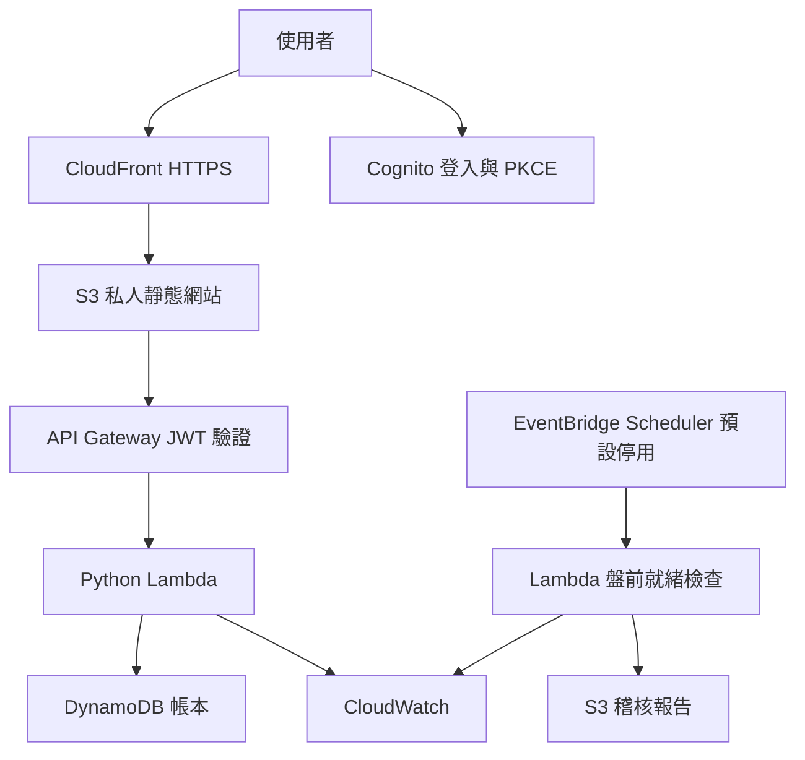
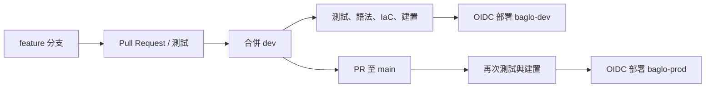

# Baglo

把直覺，交給驗證。以 Python 與 AWS Serverless 建立的股票研究、AI 建議與模擬交易專案。

## 目前可以做什麼

- 靜態、響應式前端：交易工作台、官方研究資料、委託紀錄。
- 以代號、名稱搜尋上市櫃普通股，提供收盤價區間篩選、鍵盤選取與清除條件。
- 富果整股／零股分開報價；未設定金鑰或來源失敗時顯示官方最近收盤參考，不冒充現價。
- 選股自動帶入參考價；改價後更新報價不覆蓋自訂限價，提供升降單位加減鍵與送出前確認。
- TWSE／TPEx 官方歷史日線、SMA20／60、營收成長率、估值與三大法人資料，逐項標示來源及日期。
- 每個帳戶初始虛擬本金 NT$300,000；限價委託、取消、資金／持倉保留。
- 下單可切換整股（張）與零股（股）：目前六檔普通股每張 1,000 股，零股每筆 1～999 股；前端換算總股數，後端獨立檢查交易類別。
- 即時顯示預估委託金額、手續費、賣出稅與保留金額；委託紀錄顯示整股／零股與張數。
- 重複請求防護、禁止放空、單筆買入最高 NT$60,000。
- 本機 SQLite 持久化；Lambda 使用 DynamoDB 條件寫入，避免並行修改覆蓋帳本。
- 本機限定的沙盒成交，用輸入限價驗證帳務；明確標示為非真實行情。
- AWS SAM 模板：Lambda、HTTP API、Cognito、DynamoDB、私人 S3、CloudFront、排程與日誌。
- GitHub Actions：測試、JavaScript 語法檢查、IaC 驗證、靜態檔建置；完成 AWS bootstrap 後可依分支自動部署。

**目前沒有行情驅動的自動撮合、OpenAI 呼叫或 AI 自動交易。** 研究室已能查看基礎官方資料，但不代表完整財報分析或 AI 判斷；部署版委託仍保持待成交。排程預設停用；啟用後目前只寫入「資料未就緒」稽核報告，不產生交易。所有帳戶均為模擬，不連接券商。

視覺方向參考 [RonDesignLab 的 E*TRADE 設計](https://dribbble.com/shots/21333645-E-TRADE-Online-Trading-Platform)：炭黑底、螢光黃綠、膠囊導覽與交易面板；保留 Baglo 品牌，自行實作元件，沒有使用參考圖的品牌素材。

## 本機啟動

需要 Python 3.12。應用本身使用標準函式庫；測試另需安裝開發依賴。

```bash
python3.12 -m venv .venv
source .venv/bin/activate
python -m pip install -r requirements-dev.txt
PYTHONPATH=backend python -m baglo.local --demo --port 8000
```

開啟 <http://127.0.0.1:8000>。本機僅綁定 loopback，由開發伺服器注入固定沙盒身分，不是雲端登入。移除 `--demo` 後仍能建立／取消委託，但不能沙盒成交。啟動時預設讀取 `.env.local`，僅允許指定的後端設定；金鑰不進入前端。本機帳本在 `data/baglo.db`，不會上傳 Git。

金額 API 一律以整數「分」傳遞，股數以整數「股」傳遞。`market_type` 為 `board_lot`（整股）或 `odd_lot`（零股），整股下單時 API 的 `quantity` 仍為總股數：1 張傳 `1000`，不是 `1`。未傳 market_type 的舊客戶端依股數推定，原有帳本與請求編號不改寫。整股數量須為 1,000 的倍數，本版最多 499 張；零股限 1～999 股。混合數量需分別委託；兩種市場共用資金與持倉保留，不能重複賣出。例如 NT$1,000 為 `100000`。交易單位依據 [TWSE 交易制度說明](https://www.twse.com.tw/zh/products/system/trading.html)；目前僅支援清單內六檔普通股，不推廣至交易單位不同的商品。

本版手續費為成交金額 0.1425%，最低 NT$20；賣出股票稅率 0.3%。未模擬委託簿、交易量、漲跌停、除權息、滑價、交易日及 T+2 交割，因此沙盒結果不能當成投資績效。

```bash
python -m pytest -q
node --check frontend/app.js
cfn-lint infra/template.yaml infra/bootstrap.yaml
python scripts/build_frontend.py
```

## API

| 方法 | 路徑 | 用途 |
|---|---|---|
| GET | `/api/health` | 公開健康檢查 |
| GET | `/api/config` | 公開前端設定，無秘密 |
| GET | `/api/account` | 自己的帳戶、持倉與委託 |
| POST | `/api/orders` | 建立委託，需 `Idempotency-Key` |
| POST | `/api/orders/{id}/cancel` | 取消自己帳戶的待成交委託 |
| POST | `/api/orders/{id}/demo-fill` | 僅本機沙盒可用 |
| GET | `/api/analysis` | AI 分析尚未設定，不產生虛構建議 |
| GET | `/api/instruments?q=2330&min_price=30&max_price=100` | 代號／名稱與價格搜尋；價格篩選以元為單位 |
| GET | `/api/market/{symbol}?market_type=odd_lot` | 富果報價或明確標示的官方收盤參考 |
| GET | `/api/history/{symbol}` | 約四個月份的未還原官方日線與均線 |
| GET | `/api/research/{symbol}` | 月營收成長、估值與法人買賣超 |

雲端由 API Gateway 驗證 Cognito access token 與 `baglo-api/access` scope。Lambda 以已驗證的 `sub` 隔離帳戶，不接受前端傳入帳戶 ID。前端使用 Authorization Code + PKCE，access token 只保留在分頁的 sessionStorage，不把金鑰放入網站。

## 資料來源與價格體驗

- 上市：TWSE OpenAPI 日成交、月營收、估值；歷史日線使用官方 STOCK_DAY 月份查詢，法人使用 T86 盤後報表。
- 上櫃：TPEx OpenAPI 日成交、月營收、估值、法人；歷史使用官方 tradingStock 月份查詢。來源成交量以張呈現時轉為股數，保留官方報表本身的精度限制。
- 富果：使用 REST Quote 與 `type=oddlot` 分開查詢整股／零股；取 `lastTrade` 的實際成交，不把 `lastTrial` 或含試撮的 `lastPrice` 當成交。
- 本版範圍為四碼、首碼 1～8 的上市櫃普通股，排除 ETF、TDR、權證與其他交易單位不同的商品；不是全商品搜尋。
- 搜尋價格是最近收盤參考，不是盤中篩選器。富果報價以成交時間、休市／試撮旗標與 120 秒時效判斷是否可標示現價；舊成交、休市與快取失效各自標示，不觸發自動成交。
- 日成交快取 15 分鐘、財務／法人／月份日線快取 6 小時、富果報價快取 30 秒。各執行個體另有短期索引快取，更新不是逐筆串流，也不保證正好每 30 秒呼叫上游。沒有前端背景輪詢。
- 本機快取在 `data/market-cache/`；Lambda 快取在 ResearchBucket 的 `market/`。更新失敗時，只能回傳標示舊快取的最近 7 天取得資料，保留原本時間；沒有快取則回傳明確錯誤。相同執行個體失敗後暫停重試 60 秒。
- 單一來源失敗時，搜尋顯示部分可用與提示。圖表只畫實際日線，快速切換標的會捨棄舊請求的畫面更新。價格缺失時可手動輸入，不能自動補成即時成交。
- 未還原股價受除權息影響；月營收出表日不是公司最早公告時間。尚未建立完整 point-in-time 基本面回測資料，不能用目前快照回填過去的 AI 決策。

### 富果本機設定

複製 `.env.example` 為 `.env.local`，填入 `BAGLO_FUGLE_API_KEY`。`.env.local` 被 Git 忽略；不要把金鑰放入 `frontend/config.json`。既有本機金鑰設定不隨 repository 上傳。

### 富果雲端設定

先在 Secrets Manager 保存金鑰（SecretString 可為純金鑰或 `{"FUGLE_API_KEY":"..."}`）。GitHub repository variables 分別設定 `BAGLO_DEV_FUGLE_SECRET_ARN`、`BAGLO_PROD_FUGLE_SECRET_ARN`，只存 ARN；部署流程將 ARN 傳入 SAM 的 `FugleSecretArn`。Lambda 角色僅可讀取指定秘密。若未提供 ARN，部署仍可用官方收盤資料，不會啟用富果報價。自管 KMS 金鑰另需檢查解密權限。

來源：[TWSE](https://openapi.twse.com.tw/)、[TPEx](https://www.tpex.org.tw/openapi/)、[Fugle Quote](https://developer.fugle.tw/docs/data/http-api/intraday/quote/)。來源權限與額度依各服務條款，本專案不繞過限流。

## 雲端架構與選用原因



- Lambda：短任務按需執行，免管理常駐主機。先避免 Pandas 等大型依賴。
- S3 + CloudFront：前端完全靜態，私人 origin 與 HTTPS，不需要 Next.js server 或 EC2。
- DynamoDB：單一帳戶的資金、持倉、委託在同一筆版本控制快照原子更新；讀取採強一致性，衝突時重新讀取。不是讀完後直接覆蓋。
- Cognito：雲端每個帳戶獨立；只允許管理者建立使用者。
- SAM／CloudFormation：宣告資源、角色、API、前端託管及排程，以環境參數建立 `baglo-dev`、`baglo-prod`。
- S3：保存原始資料及日後分析快照，避免把大量資料放在 Lambda 暫存磁碟。

帳本 MVP 最多 150 筆委託／300 KB，達上限明確拒絕新委託，不刪除舊紀錄；下一階段改為獨立委託／成交項目與交易寫入。S3、資料表、使用者池刪除 stack 後保留，仍可能計費。DynamoDB PITR、CloudFront、Cognito、日誌與 CI 分鐘也需依帳號額度估費；此模板不保證全部免費。

## CI/CD 與首次設定



所有推送與 PR 都執行 CI。AWS 部署只有在相應 repository variable 設定後啟用；目前尚未在 AWS 建立新資源或設定 GitHub variables。CloudFormation bootstrap、Cognito 真實登入與部署後端到端尚待 AWS 實測。

### 1. 首次 AWS bootstrap

在已登入、具資源建立權限的 AWS CloudShell，從此 repository 根目錄執行。先檢視 `infra/bootstrap.yaml`：它建立 GitHub OIDC 部署角色、CloudFormation 執行角色及 artifact bucket，**會建立 IAM 權限與可能計費的資源**。CloudFormation 執行角色的 CloudFront 及部分建立 API 權限為服務範圍，其他角色與多數資源限制在指定環境；適合獨立練習帳號，正式組織應再套用 permissions boundary。

帳號若已有 `token.actions.githubusercontent.com` OIDC provider，須以 `ExistingOidcProviderArn` 傳入既有 ARN，不可重建同一 provider。

```bash
aws cloudformation deploy --region us-east-1 \
  --template-file infra/bootstrap.yaml --stack-name baglo-bootstrap-dev \
  --capabilities CAPABILITY_IAM \
  --parameter-overrides Environment=dev Repository=kos8123/Baglo

aws cloudformation describe-stacks --region us-east-1 \
  --stack-name baglo-bootstrap-dev --query 'Stacks[0].Outputs'
```

正式環境重複建立 `baglo-bootstrap-prod`，傳入 `Environment=prod` 及第一個 stack 輸出的 `ExistingOidcProviderArn=...`。不要直接執行原 CloudQuant 的部署腳本或修改原 stack。

### 2. GitHub 設定

在 repository 設定 `dev`、`prod` environments，dev 僅允許 dev 分支，prod 僅允許 main 分支。角色信任限於 `kos8123/Baglo` 的指定 environment，不存放長期 AWS Access Key。

將各環境 bootstrap 輸出加入 **repository variables**：

| Variable | 輸出 |
|---|---|
| `BAGLO_DEV_ROLE_ARN` / `BAGLO_PROD_ROLE_ARN` | DeployRoleArn |
| `BAGLO_DEV_CFN_ROLE_ARN` / `BAGLO_PROD_CFN_ROLE_ARN` | CloudFormationRoleArn |
| `BAGLO_DEV_ARTIFACT_BUCKET` / `BAGLO_PROD_ARTIFACT_BUCKET` | ArtifactBucket |

設定完成後，推送 dev 自動部署測試環境，main 自動部署正式環境；同環境部署會序列化，不會互相取消。可依 GitHub 方案支援程度在 prod environment 加人工核准，但第一版不依賴此付費能力。

部署腳本：`scripts/deploy.sh dev|prod`。流程為 SAM build/deploy → 靜態前端 config 建置 → S3 sync → CloudFront invalidation → 公開健康檢查與未登入帳戶應回 401 的檢查。兩個環境的資料、網站與使用者池獨立。

管理者需在部署後的 Cognito 使用者池建立自己的登入帳戶；透過 Cognito 頁面完成首次密碼變更，不把密碼或 token 提交至 repository。雲端不提供本機沙盒身分或成交按鈕。

## 已驗證的使用者流程

- 代號、中文名稱、全形數字、台／臺與 `.TW` 後綴搜尋；能選到原本六檔以外的上市、上櫃股票。
- 以價格區間篩選時清除原本的已選搜尋文字；最多顯示 20 個建議，可進一步輸入名稱縮小範圍。
- 輸入新搜尋立即取消舊建議的可選狀態；未選擇新標的時，禁止誤將搜尋文字當作已選股票送單。
- 方向鍵與 Enter 選取、Escape 關閉建議，選取列捲入可視範圍。
- 選股自動帶入富果對應市場報價；手動改價後按更新保留自訂值，按帶入參考價才恢復自動價格。
- 下單確認視窗按 Escape 不新增委託；按確認只新增一筆，取消後釋放保留資金。
- 圖表只呈現實際取得的資料；上櫃歷史成交量的張／股換算有測試。
- 來源失敗、部分市場不可用、舊快取、休市成交價與即時報價不混用；並行與重複委託維持原本帳務測試。

本機使用者體驗已操作驗證；AWS 部署後的來源可達性、Secrets Manager 與登入流程仍需在雲端實測。

## 下一階段

1. 擴充完整財報、公告時間、歷史修訂版本與盤前資料品質檢查；已有基礎來源接入，但尚未啟用每日 AI 分析。
2. 補齊交易日、流動性、報價買賣盤單位與撮合規則，再實作行情驅動模擬成交與交割限制。
3. OpenAI 結構化建議介面與模型評估；API 金鑰保存在後端秘密管理，失敗或缺資料即不產生交易。
4. AI 推薦需手動確認；自動模式另設定現金、持倉與單日額度，避免與手動模式重複委託。
5. 分別比較手動、固定規則及 AI 的成本後績效，不以短期沙盒結果宣稱獲利。

## AI 輔助開發紀錄

使用 Codex 協助需求拆解、Python 帳務與儲存介面、靜態 UI、SAM 模板、CI/CD 與測試案例。人工需求包括純模擬、從零開始、免費優先、獨立 Git 歷史。開發驗證包含單元測試、並行寫入與隔離測試、模板 lint，以及本機瀏覽器實際建立／成交沙盒委託。

心得：AI 可以加快第一版，但必須用測試驗證資金守恆、重複請求與權限邊界；模板 lint 不代表 AWS 部署成功，UI 有按鈕也不代表資料或模型已接入。限制與未實作功能必須在畫面及文件直接呈現。
