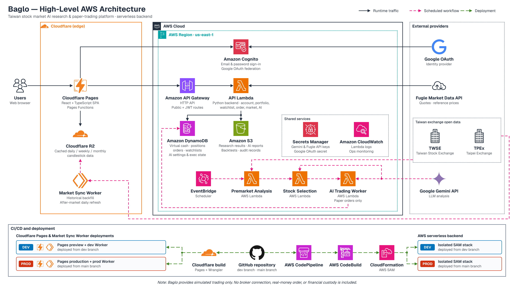
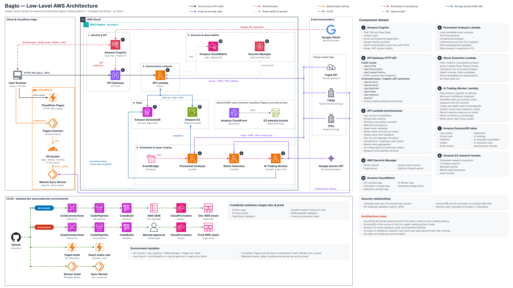

# Baglo 雲端架構

Baglo 是台股 AI 研究與模擬交易平台。系統只建立虛擬資金、持倉與委託，不串接券商，也不送出真實交易。

## High-Level Architecture



- Edge 層提供 React 前端、Pages Functions、R2 K 線快取與 Market Sync Worker。
- Amazon Cognito 處理 Email／密碼及 Google OAuth。
- API Gateway 與 API Lambda 提供公開行情及受 JWT 保護的帳戶功能。
- DynamoDB 保存模擬帳務、自選股與 AI 執行狀態。
- S3 保存研究、回測、報告與稽核資料。
- EventBridge 啟動盤前分析、股票選擇與 AI 模擬交易流程。
- TWSE、TPEx、Fugle、Google OAuth 與 Gemini 是 AWS 外部服務。
- GitHub、CodePipeline、CodeBuild 與 CloudFormation 負責環境隔離的部署流程。

## Low-Level Architecture



### Client and edge

- 瀏覽器載入 React／TypeScript SPA。
- Pages Function 從 R2 讀取預先整理的日、週、月 K 線。
- Market Sync Worker 負責歷史回填及收盤後增量更新。

### Identity and synchronous API

- Cognito 使用 OAuth authorization-code flow with PKCE 發出 JWT。
- API Gateway 將公開路由與受保護路由分開。
- API Lambda 處理帳戶、虛擬資金、持倉、委託、自選股、AI 設定與研究結果。

### Scheduled AI workflow

```text
EventBridge → Premarket Analysis → Stock Selection → AI Trading Worker
```

- Premarket Analysis 整理技術面、基本面與籌碼面資料。
- Stock Selection 驗證資料完整度、評分多檔高流動性股票並呼叫 Gemini。
- AI Trading Worker 套用信心、資金、曝險與持倉限制後建立模擬委託。
- 任一資料、模型或風控步驟失敗時不建立委託，並保存失敗原因。

### Data, security and operations

- DynamoDB 保存使用者、虛擬資金、持倉、委託、自選股、AI 設定與 idempotency records。
- S3 保存研究快照、AI 報告、回測及稽核資料。
- Secrets Manager 保存 Gemini、Fugle 與 Google OAuth Secret。
- CloudWatch 保存 Lambda 日誌及部署後診斷資訊。
- 瀏覽器與公開前端不得取得後端 Secret。

## 架構限制

- 行情可能受第三方 API 延遲、額度、缺漏或中斷影響。
- 模擬成交尚未完整還原委託簿、公司行動與所有市場特例。
- AI 輸出必須通過程式化風控，且不保證正確或獲利。
- 系統不具券商連線、真實資金或金融資產保管功能。
