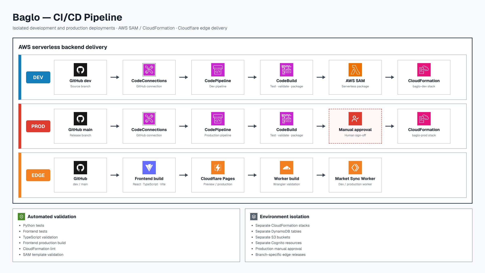
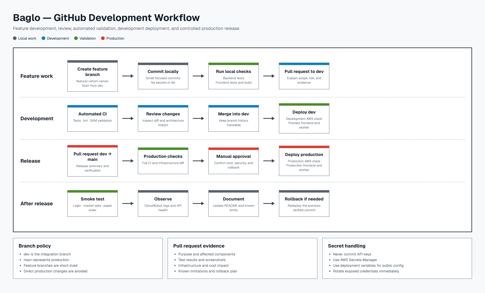

# Baglo CI/CD與Git工作流

部署依變更路徑觸發，前端、Worker 與 AWS 後端分開。文件更新不觸發部署，設定與套用方式請見 [部署路徑](DEPLOY_PATHS.md)。

Baglo使用GitHub作為程式碼來源，AWS CodePipeline、CodeBuild、SAM與CloudFormation負責後端驗證及部署。開發環境與正式環境使用不同的pipeline與CloudFormation stack。

## CI/CD Pipeline



| Git branch | AWS environment | Deployment behavior |
| --- | --- | --- |
| `dev` | `baglo-dev` | 測試成功後自動部署開發環境。 |
| `main` | `baglo-prod` | 測試成功後等待人工核准，再部署正式環境。 |

兩個環境各自擁有CloudFormation stack、DynamoDB、S3、Cognito與設定，避免測試資料或錯誤部署影響正式環境。

### AWS後端流程

1. GitHub分支異動由AWS CodeConnections傳入CodePipeline。
2. CodeBuild執行Python、前端、TypeScript、CloudFormation與SAM驗證。
3. AWS SAM封裝Lambda與IaC。
4. CloudFormation更新對應環境的serverless stack。
5. 正式環境在CloudFormation部署前保留人工核准。

### Edge流程

前端與Market Sync Worker依`dev`／`main`產生preview／production版本。公開設定可以由建置變數注入，但Gemini、Fugle、Google OAuth Secret與AWS憑證不得進入前端產物。

## GitHub Workflow



1. 從`dev`建立短期`feature/<name>`分支。
2. 完成功能後先執行本機測試，再建立Pull Request到`dev`。
3. CI通過且差異確認完成後合併，部署開發環境。
4. 驗證登入、行情、K線、模擬委託與AI流程。
5. 建立`dev → main` release PR。
6. 完整CI與基礎設施差異檢查成功後，人工核准正式部署。
7. 部署後執行smoke test並查看CloudWatch；有問題時重新部署上一個已驗證commit。

## 第一次建立Pipeline

在AWS CloudShell的repo根目錄執行：

```sh
export AWS_REGION=us-east-1
aws sts get-caller-identity --no-cli-pager
aws codeconnections list-connections --region "$AWS_REGION" --output table --no-cli-pager
```

Connection必須是`AVAILABLE`，而且GitHub App已授權`kos8123/Baglo`。CLI可以建立connection，但GitHub App的互動授權仍需在AWS Console完成。

建立或更新開發環境：

```sh
bash scripts/setup_secrets.sh dev
# 執行腳本輸出的 Secret ARN exports
export BAGLO_ENVIRONMENTS=dev
bash scripts/setup_codepipeline.sh 'AVAILABLE_CONNECTION_ARN'
```

正式環境應在`dev`驗證完成並合併至`main`後建立：

```sh
bash scripts/setup_secrets.sh prod
# 執行腳本輸出的 Secret ARN exports
export BAGLO_ENVIRONMENTS=prod
bash scripts/setup_codepipeline.sh 'AVAILABLE_CONNECTION_ARN'
```

## 確認部署

```sh
aws codepipeline get-pipeline-state \
  --region us-east-1 --name baglo-dev-pipeline \
  --query 'stageStates[].{Stage:stageName,Status:latestExecution.status}' \
  --output table --no-cli-pager

aws cloudformation describe-stacks \
  --region us-east-1 --stack-name baglo-dev \
  --query 'Stacks[0].Outputs' --output table --no-cli-pager
```

部署完成必須同時符合：

- Pipeline的Source、Validate與Deploy全部成功。
- CloudFormation stack狀態成功。
- `/api/health`回傳正確release與`paper_only`狀態。
- 匿名使用者無法讀取帳戶API。
- 登入、行情、K線與模擬委託smoke test通過。

## 失敗處理

- Source找不到branch：確認Connection授權的repository與branch名稱。
- CodeBuild concurrency：等待進行中的build完成，不要同時重複啟動。
- IAM `AccessDenied`：只補上失敗動作需要的最小權限。
- CloudFormation rollback：先讀stack events，修正template或參數，不可刪除帳本規避問題。
- 回退程式：建立revert commit，再走相同pipeline；不要force push `main`。

## 圖片產生方式

CI/CD與GitHub Workflow圖由版本化HTML透過[Takumi CLI](https://takumi.kane.tw/docs/cli)產生：

```sh
pnpm dlx @takumi-rs/cli@latest image docs/architecture/cicd-pipeline.html \
  -o docs/architecture/cicd-pipeline.png --width 2400 --height 1350

pnpm dlx @takumi-rs/cli@latest image docs/architecture/github-workflow.html \
  -o docs/architecture/github-workflow.png --width 2400 --height 1450
```
