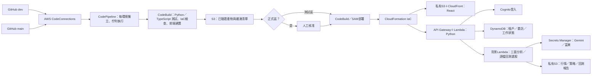
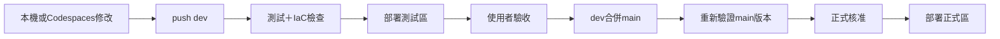

# Baglo 雲端開發與 CI/CD

目前狀態：dev CI/CD 已建立；首次部署修正與驗收進行中。實際上線版本以 CodePipeline 成功執行與 CloudFormation 輸出為準，不能只以本文件推論。

## 架構與分支



- `dev`：自動測試、部署 `baglo-dev`，與正式帳本、使用者、網站隔離。
- `main`：自動測試後等待核准，再部署 `baglo-prod`。第一次建正式 pipeline 前，先把完整程式合併進 main，不能仍是空 repo。
- CloudFormation 也隨已驗證的 Git 版本更新。第一次建立信任角色與 pipeline 需在 CloudShell 執行一次；之後日常 push 不需重新安裝。
- AWS 沒有真正免費或無上限的承諾：CodeBuild、CodePipeline、Secrets Manager、儲存、模型皆可能計費。先只建 dev，排程預設停用。

## 一支腳本接續建立

在已登入的 AWS CloudShell、repo dev 分支根目錄執行 `bash scripts/cloudshell_start.sh dev`。它會重用或建立專用 `baglo-github` 連線；若仍 PENDING，提供瀏覽器授權連結後停止，不建立 pipeline。完成 GitHub 授權後重跑同一命令，會重用既有金鑰、建立缺少的金鑰，再接續 bootstrap／pipeline。只針對 Baglo，不修改舊 CloudQuant 資源。

## 第一次設定（AWS CloudShell）

開啟 **us-east-1** 的 CloudShell，取得 repo 的 dev 分支。私人 repo 請使用你既有的 GitHub 登入或上傳原始碼；不要把 PAT、AWS AK/SK 放進 repo。

在 repo 根目錄執行：

```sh
export AWS_REGION=us-east-1
aws sts get-caller-identity --no-cli-pager
aws codeconnections list-connections --region "$AWS_REGION" --output table --no-cli-pager
```

使用同區域、`AVAILABLE`、GitHub App 已授權 `kos8123/Baglo` 的 connection。若還沒有：

```sh
aws codeconnections create-connection \
  --region "$AWS_REGION" --provider-type GitHub --connection-name baglo-github \
  --no-cli-pager
```

新建 connection 是 `PENDING`，必須到 AWS Developer Tools → Settings → Connections 完成 GitHub App 授權，然後確認成為 `AVAILABLE`。CLI 無法替你完成互動授權。

建立後端金鑰（輸入隱藏，不會顯示金鑰本體；此操作會建立或更新收費的 Secrets Manager secret）：

```sh
bash scripts/setup_secrets.sh dev
```

將輸出的兩行 `export BAGLO_DEV_..._SECRET_ARN=...` 在目前 CloudShell 執行。這些是 ARN，不是金鑰。

```sh
export BAGLO_ENVIRONMENTS=dev
bash scripts/setup_codepipeline.sh '你的 AVAILABLE connection ARN'
```

這會建立 dev bootstrap 與 dev pipeline，首次 pipeline 會抓 GitHub dev 自動建置。GitHub App 仍沒 repo 權限時，只需修正 connection 後重試 Source，不需重建 EC2 或其他歷史 CloudQuant 資源。

## 正式區

先完成 dev 的登入與功能驗收，再合併 dev → main。不要用 force push 覆蓋 main。

```sh
bash scripts/setup_secrets.sh prod
# 執行輸出的 BAGLO_PROD_*_SECRET_ARN export
export BAGLO_ENVIRONMENTS=prod
bash scripts/setup_codepipeline.sh '同一個已授權 Baglo 的 connection ARN'
```

正式 pipeline 的 `ApproveProduction` 核准後才部署。prod 不共用 dev 的 DynamoDB、Cognito 或資料 bucket。不同環境可放同一供應商金鑰，但需自行管控共用模型配額。

## 如何確認部署成功

```sh
aws codepipeline get-pipeline-state --region us-east-1 --name baglo-dev-pipeline \
  --query 'stageStates[].{Stage:stageName,Status:latestExecution.status}' --output table --no-cli-pager
aws cloudformation describe-stacks --region us-east-1 --stack-name baglo-dev \
  --query 'Stacks[0].Outputs' --output table --no-cli-pager
```

1. Pipeline Source／Validate／Deploy 全部成功（prod 還需核准）。
2. CloudFormation `WebsiteUrl` 可開啟；`/release.json` 的 commit 應與該次 Source revision 一致。
3. `ApiUrl/api/health` 回傳 `ok:true`、`paper_only` 與相同 release；匿名 `/api/account` 必須回 401。
4. 用管理員建立一個 Cognito 使用者。預設不開放公眾註冊；首次登入處理密碼變更後，測試帳戶、選股研究與模擬委託。
5. 雲端不提供本機「沙盒成交」按鈕。委託不會自動撮合成交，不可把 pending 委託宣稱為實際績效。

部署腳本會驗證已測試產物的檔案清單與雜湊，不重新建置前端，只注入公開 API URL。後端與網站皆帶 source commit，避免前後端版本誤判。若網站上傳失敗，整個 Deploy 會失敗，不會假報成功；S3 前端與後端更新並非跨服務原子交易。

## 背景 AI 與排程

- Gemini 金鑰只在後端透過 Secrets Manager 讀取，不進前端或 build 日誌。
- 多檔選股拆成逐檔 Lambda 工作，最多20檔；帳本中的 claim 防止重複事件重跑模型。每段保存策略與結果後才排下一段。
- 模型或工作失敗不自動切換模型；背景 Lambda 失敗不自動重新推理。若工作逾時，頁面會顯示失敗，需人工檢查，不能補造訊號。
- 排程預設 `DISABLED`。需要時在**單一環境**設定 `BAGLO_AI_ACCOUNTS` 為明確的 Cognito sub 清單與 `BAGLO_AI_SCHEDULE=ENABLED`，重跑該環境 pipeline 設定腳本，再執行 pipeline 才會更新應用堆疊。
- 平日08:30開始研究；09:05後每5分鐘檢查，程式只允許至13:30。必須同時有使用者啟用、當日回測選中股票、同向策略／AI訊號及可信即時報價才建立模擬委託。交易所假日或資料不完整可能跳過／消耗研究額度；目前沒有獨立交易所行事曆服務。
- 執行器最多選一檔進行當日決策，並非完整多部位再平衡系統。仍需實作自動撮合與完整持倉退出流程，才能宣稱完整自動交易閉環。

## 在雲端寫程式（選用）

CI/CD 是自動驗證與部署，不等於開發環境。若要連編輯器也搬到雲端，可在 GitHub → Code → Codespaces 建立 dev 分支工作區；`.devcontainer/devcontainer.json` 會安裝 Python、Node24、pnpm 與測試依賴。

設定自己的 `.env.local`（gitignore 已排除）或使用 Codespaces secrets；不要複製本機帳本當作正式帳本。啟動：

```sh
PYTHONPATH=backend python -m baglo.local --demo --env-file .env.local --port 8000
```

此伺服器使用固定的本機沙盒身分、沒有雲端登入保護；8000埠必須維持 Codespaces 的 **Private** 可見性，不得公開。Codespaces 的費用／免費額度與 AWS 分開計算。

## 日常工作流程



測試區使用保留失敗資源模式，方便修復後接續部署；正式區保留自動回滾。失敗時先讀該次 CodeBuild 日誌；重試同一失敗階段即可，不需要從頭建立基礎設施。回退程式請在 Git 建立 revert commit，再經 pipeline；DynamoDB 與研究資料預設 Retain，不刪帳本解決部署問題。
